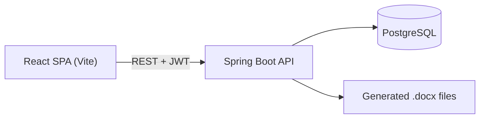
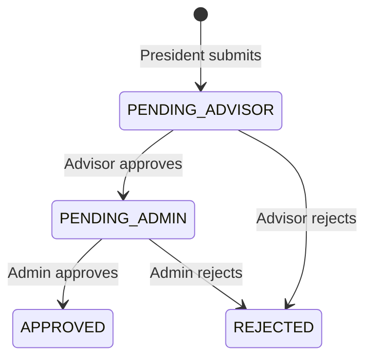

# Event Approval System

A role-based web application that digitizes the student club event petition process: a club president submits an event request, the club advisor reviews it, and an administrator gives the final approval.

## Overview

Student club events normally require a paper petition that travels between the club president, the academic advisor and the faculty administration. This project moves that flow into a Spring Boot REST API and a React single-page app. Every petition is tracked through explicit statuses, a Word (`.docx`) petition document is generated automatically for each request, and a shared calendar shows which dates are already taken.

The application UI is in Turkish. It is branded as "KYCUBYO" in the login screen and sidebar; the repository and Maven artifact are named *Event Approval System*.

## Features

- **JWT authentication** with stateless sessions, BCrypt password hashing and registration/login endpoints.
- **Three roles** with access enforced both in the security filter chain and with `@PreAuthorize`:
  - `PRESIDENT` (club president): creates petitions and follows their own requests.
  - `ADVISOR` (club advisor): reviews petitions of the club they advise.
  - `ADMIN` (deputy director): gives final approval, manages clubs, sees every petition.
- **Approval workflow**: `PENDING_ADVISOR` -> `PENDING_ADMIN` -> `APPROVED`, with rejection (and an optional rejection reason) possible at the advisor and admin stages.
- **Automatic Word document generation** (Apache POI): a two-page document per petition, consisting of a petition letter and an "EK-1" event preparation workflow table. Documents can be downloaded from the API.
- **Event calendar**: a month view of all non-rejected petitions, colored by status.
- **Date-conflict warning**: before submitting, the petition form checks for overlapping petitions and asks the president to confirm.
- **Club management** for admins: create clubs and assign an advisor and a president.
- Sortable tables, status badges, toast notifications and form validation (React Hook Form + Zod).

## Architecture





The backend follows a layered structure (controller, service, repository, entity) with DTOs as Java records, MapStruct mappers and a global exception handler.

## Tech Stack

| Layer | Technology |
| --- | --- |
| Backend | Java 17, Spring Boot 3.5.12 (Web, Data JPA, Security, Validation) |
| Database | PostgreSQL (schema managed by Hibernate `ddl-auto: update`) |
| Auth | JJWT 0.12.6, Spring Security, BCrypt |
| Mapping / boilerplate | MapStruct 1.5.5.Final, Lombok |
| Documents | Apache POI (poi-ooxml) 5.2.5 |
| Frontend | React 19, Vite 8, React Router 7 |
| Frontend libraries | Tailwind CSS 4, Zustand 5, Axios, React Hook Form 7, Zod 4, date-fns 4, flatpickr, react-hot-toast |
| Tooling | Maven Wrapper, ESLint 9 |

## API Overview

| Method | Endpoint | Access | Description |
| --- | --- | --- | --- |
| POST | `/api/auth/register` | Public | Create a user |
| POST | `/api/auth/login` | Public | Log in, returns a JWT, username and role |
| POST | `/api/petitions` | PRESIDENT | Create a petition (generates the Word document) |
| GET | `/api/petitions/me` | Authenticated | Petitions created by the current user |
| GET | `/api/petitions/{id}` | Authenticated | Petition details |
| GET | `/api/petitions/{id}/download` | Authenticated | Download the generated `.docx` |
| GET | `/api/petitions/calendar` | Authenticated | All non-rejected petitions for the calendar |
| GET | `/api/petitions/check-date?startDate=&endDate=` | Authenticated | Active petitions overlapping a date range |
| GET | `/api/advisor/petitions` | ADVISOR | Petitions of the advisor's club |
| PUT | `/api/advisor/petitions/{id}/approve` | ADVISOR | `PENDING_ADVISOR` -> `PENDING_ADMIN` |
| PUT | `/api/advisor/petitions/{id}/reject` | ADVISOR | Reject, optional `reason` query parameter |
| GET | `/api/admin/petitions` | ADMIN | Petitions waiting for admin approval |
| GET | `/api/admin/petitions/all` | ADMIN | All petitions |
| PUT | `/api/admin/petitions/{id}/approve` | ADMIN | `PENDING_ADMIN` -> `APPROVED` |
| PUT | `/api/admin/petitions/{id}/reject` | ADMIN | Reject, optional `reason` query parameter |
| GET | `/api/admin/users` | ADMIN | List users |
| GET / POST | `/api/admin/clubs` | ADMIN | List / create clubs |

## Project Structure

```
EventApprovalSystem/
├── backend/                      Spring Boot application
│   ├── .env.example              Environment variable template
│   └── src/main/
│       ├── resources/application.yml
│       └── java/tr/edu/trakya/kycuby/eventapproval/
│           ├── config/           Security and CORS configuration
│           ├── controller/       Auth, Petition, Advisor, Admin, Club endpoints
│           ├── service/          Workflow logic, Word document generation
│           ├── entity/           User, Club, Petition, Role, PetitionStatus
│           ├── security/         JWT provider, filter, user details service
│           └── dto/ mapper/ repository/ exception/
└── frontend/                     React single-page app
    └── src/
        ├── pages/                auth, president, advisor, admin, dashboard
        ├── components/           Calendar, Layout, Modal, ProtectedRoute, ...
        ├── services/             Axios client and API wrappers
        └── store/                Zustand auth store
```

## Getting Started

### Prerequisites

- JDK 17
- Node.js and npm
- A running PostgreSQL instance and an empty database

### Backend

1. Copy `backend/.env.example` to `backend/.env` and fill in the values. The application reads these variables:

   | Variable | Purpose |
   | --- | --- |
   | `DB_HOST`, `DB_PORT`, `DB_NAME` | PostgreSQL connection |
   | `DB_USERNAME`, `DB_PASSWORD` | PostgreSQL credentials |
   | `JWT_SECRET` | Base64-encoded HMAC key used to sign tokens |
   | `JWT_EXPIRATION` | Token lifetime in milliseconds |
   | `SERVER_PORT` | API port |
   | `DOCUMENT_OUTPUT_DIR` | Folder for generated `.docx` files |

   Spring Boot does not load `.env` files on its own, so export these variables in your shell or IDE run configuration. Always set your own `JWT_SECRET` and database password.

2. Start the API:

   ```bash
   cd backend
   ./mvnw spring-boot:run      # Windows: mvnw.cmd spring-boot:run
   ```

   The API listens on `http://localhost:8080` by default.

### Frontend

```bash
cd frontend
npm install
npm run dev
```

The dev server runs on `http://localhost:5173`. The API base URL (`http://localhost:8080/api`) is set in `frontend/src/services/api.js`, and the backend CORS configuration allows the `http://localhost:5173` origin.

Other scripts: `npm run build`, `npm run lint`, `npm run preview`.

### First use

1. Register users for each role on the `/register` page.
2. Log in as an `ADMIN` and create a club under "Kulüp Yönetimi", assigning an advisor and a president.
3. Log in as the president to submit a petition, then as the advisor and the admin to approve it.

## Notes and Limitations

- The only test is the default Spring context test.
- Date conflicts are only a warning in the UI; admin approval is not blocked (the backend check is commented out in `PetitionService`).
- Generated documents are stored on the local filesystem of the API host.
